# KoRo Analytics Engineering & AI-ready Data Platform POC

[](https://github.com/your-org/koro-analytics-engineering-poc/actions)
[](https://www.getdbt.com/)
[](https://cloud.google.com/bigquery)
[](https://streamlit.io/)

An end-to-end Analytics Engineering and AI-ready Data Platform proof-of-concept (POC) built for e-commerce (KoRo). It transforms raw operational and public web data into trusted, reusable dimensional data assets, power traditional BI dashboards, and exposes semantic context to AI-powered self-service analytics.

---

## 🏗️ Architecture Overview

```mermaid
flowchart LR
    subgraph Sources [Source Layer]
        S1[KoRo Website / Scraper]
        S2[Shopware 6 API]
        S3[Synthetic Orders/Returns]
    end

    subgraph Ingestion [Ingestion & Validation]
        I1[Python Extractors]
        I2[Pydantic Data Contracts]
    end

    subgraph Medallion [BigQuery Data Warehouse]
        B1[(Bronze / Raw)]
        B2[(Silver / Staging & Int)]
        B3[(Gold / Marts & Star Schema)]
    end

    subgraph Semantic [Semantic & Knowledge Layer]
        K1[Taxonomy & Ontology]
        K2[Metrics & Business Rules]
        K3[NetworkX Knowledge Graph]
    end

    subgraph Consumption [Consumption Layer]
        C1[Streamlit BI Dashboard]
        C2[AI Analytics Assistant / MCP]
    end

    Sources --> Ingestion
    Ingestion --> B1
    B1 -->|dbt clean & deduplicate| B2
    B2 -->|dbt dimensional model| B3
    B3 --> Semantic
    B3 --> C1
    Semantic --> C2
```



---

## 📁 Repository Structure

```
├── .github/workflows/ci.yml     # Automated CI testing and validation
├── ai/                          # AI Assistant, tools, LLM clients & prompts
├── contracts/                   # Data contract specifications (YAML)
├── dashboard/                   # Streamlit BI application
├── docs/                        # Specifications, mappings, and data dictionaries
├── evaluation/                  # Benchmark questions & AI evaluation framework
├── ingestion/                   # Python scrapers, Shopware API clients, validators
├── knowledge/                   # Taxonomy, ontology definitions & graph builders
├── metadata/                    # Data catalog and business glossary
├── monitoring/                  # Data quality tests & LLM observability
├── semantic/                    # Metric definitions and business rules
├── tests/                       # Unit, integration, and regression tests
├── warehouse/dbt_project/       # dbt project (Bronze, Silver, Gold models)
├── .env.example                 # Environment variable templates
├── requirements.txt             # Python dependencies
└── README.md                    # Project documentation
```

---

## 🚀 Quickstart

### 1. Clone & Setup Environment
```bash
git clone https://github.com/your-org/koro-analytics-engineering-poc.git
cd koro-analytics-engineering-poc
python -m venv .venv
source .venv/bin/activate  # On Windows: .venv\Scripts\activate
pip install -r requirements.txt
cp .env.example .env
```

### 2. Run Ingestion Pipelines
```bash
python ingestion/main.py --source all
```

### 3. Run dbt Transformations & Data Quality Tests
```bash
cd warehouse/dbt_project
dbt deps
dbt run
dbt test
```

### 4. Launch BI Dashboard & AI Assistant
```bash
streamlit run dashboard/app.py
```

---

## 📊 Core Business KPIs

* **Gross Revenue**: Total revenue before discounts and refunds.
* **Net Revenue**: Revenue after discounts and refunds.
* **Units Sold**: Total volume of products sold.
* **Average Order Value (AOV)**: Net revenue divided by total valid orders.
* **Average Selling Price (ASP)**: Net product revenue divided by units sold.
* **Return Rate**: Returned units divided by total sold units.
* **Product Availability**: Available products divided by total catalog size.

---

## ⚖️ Disclaimer
Public product information and synthetic transactional data must be strictly separated. Synthetic data generated for demonstration purposes does not reflect KoRo's internal proprietary sales records.
