# KoRo Analytics Engineering & Governed AI Copilot Platform

[](https://koroae-emnrmedur9bkudgaygri4f.streamlit.app/)
[](https://www.getdbt.com/)
[](https://duckdb.org/)
[](https://www.elementary-data.com/)
[](https://cloud.langfuse.com/)

---

### 💡 What Problem Does This POC Solve? (The Executive Storyline)

In modern e-commerce data platforms, Analytics Engineers are overwhelmed by ad-hoc business requests, while unguided AI copilot queries often produce warehouse-breaking hallucinations, phantom entities, and severe financial fan-out errors (e.g. cross-fact 1:N double-counting).

This production-grade Lakehouse POC bridges the gap between commercial stakeholders and data engineering:
1. **Stakeholders Inquire in Natural Language**: Commercial teams ask nuanced questions (e.g., *"How does 1kg bulk packaging affect return rates across DE vs. FR markets?"*) via a guided Socratic clarification workflow.
2. **Context-Engineered Semantic Mapping**: Instead of guessing SQL, the Copilot dynamically inspects physical DuckDB metadata, conformed Kimball star-schema grains (`fct_orders`, `fct_order_items`, `fct_returns`, `dim_products`), and active dimension values to prevent phantom filters.
3. **Automated dbt Contract & SQL Compilation**: The system compiles a signed specification memo into a fully governed dbt model (`.sql`) alongside its version-controlled data contract (`schema.yml`), validated by live DuckDB dry-runs before deployment.
4. **End-to-End Observability with Elementary & Langfuse**: Data quality, volume anomalies, and schema freshness are continuously monitored via embedded **Elementary Data Observability**, while LLM reasoning and semantic grounding are instrumented with **Langfuse** tracing.

---

## 🎯 Scope Matrix: Current POC vs. Future Production Roadmap

To uphold the **Zero-Facade Standard**, this repository strictly distinguishes between what is implemented and physically verified in this POC versus the production scaling architecture for an enterprise deployment:

| Domain | Current POC Scope (Implemented & Governed) | Future Production Roadmap (Enterprise Scale) |
| :--- | :--- | :--- |
| **Storage & OLAP Engine** | **DuckDB (In-Process OLAP)** + local Parquet storage (`data/bronze/*.parquet`, `data/koro_lakehouse.duckdb`).<br>• Zero cloud cost, single-node high performance.<br>• Verified dimensional modeling and Kimball star-schema feasibility. | **Cloud Data Warehouse Migration**: Seamless cutover to **Snowflake / BigQuery / Databricks** via standard dbt adapter swap (`dbt-snowflake` / `dbt-bigquery`). Object storage on AWS S3 / GCS. |
| **Data Quality & Observability** | **Elementary Data + dbt Tests + Langfuse**:<br>• Embedded **Elementary Data Observability Report** (table health, test history, freshness/volume anomalies).<br>• 18+ automated dbt contract tests (`unique`, `not_null`, `relationships`) with 100% PASS.<br>• Real-time **Langfuse** LLM tracing & semantic grounding evaluation. | **Real-time Alerting & Remediation**:<br>• Direct integration with **Slack / PagerDuty Webhooks** for instant incident alerting.<br>• Automated data drift detection and self-healing / rollback pipelines. |
| **Semantic & Context Layer** | **Physical Metadata Reflection & YAML Rules**:<br>• `DatabaseReflectionService` dynamically reflects physical DuckDB tables.<br>• `semantic/business_rules.yaml` governs KPI formulas & contract mappings.<br>• `metadata/business_glossary.yaml` standardizes bulk packaging & defect definitions. | **Enterprise Semantic Layer & Knowledge Graph**:<br>• Adoption of **dbt Semantic Layer (MetricFlow)** or Cube.<br>• Optional **NetworkX / Neo4j Knowledge Graph** for multi-hop ontology traversal across tens of thousands of SKUs. |
| **Transformation & Orchestration** | **dbt-duckdb 3-Tier Medallion Pipeline**:<br>• Bronze Sources $\rightarrow$ Silver Facts/Dims $\rightarrow$ Gold Marts.<br>• Local automated orchestrator script (`scripts/run_pipeline.py`).<br>• CI automation via GitHub Actions (`.github/workflows/ci.yml`). | **Production Workflow Orchestration**:<br>• Enterprise DAG scheduling via **Apache Airflow / Dagster / dbt Cloud**.<br>• Hourly/daily incremental model execution (`incremental_strategy='merge'`). |
| **AI Copilot & Socratic Governance** | **Zero-Facade Socratic Compiler**:<br>• Multi-turn requirement clarification, entity boundary enforcement.<br>• Dynamic dbt Model + Data Contract (`schema.yml`) generation.<br>• Pre-deployment physical DuckDB Dry-Run validation. | **GitOps Automated PR & Slack Bot**:<br>• AI commits compiled dbt models directly to GitHub Pull Requests.<br>• Pre-commit CI validation via `dbt-checkpoint`.<br>• Bidirectional Slack/Teams conversational copilot. |

---

## 🏗️ Architecture Overview

```mermaid
flowchart LR
    subgraph Sources [Source Layer]
        S1[KoRo Website / Scraper]
        S2[Shopware 6 API]
        S3[Synthetic Orders/Returns]
    end

    subgraph Ingestion [Ingestion & Validation]
        I1[Python Extractors]
        I2[Pydantic Data Contracts]
    end

    subgraph Medallion [DuckDB Lakehouse In-Process OLAP]
        B1[(Bronze / Raw Parquet)]
        B2[(Silver / Kimball Star Schema)]
        B3[(Gold / Governed Marts)]
    end

    subgraph Semantic [Semantic & Context Layer]
        K1[Taxonomy: dim_categories / dim_products]
        K2[Metrics & Rules: semantic/business_rules.yaml]
        K3[Catalog & Glossary: metadata/*.yaml]
    end

    subgraph Observability [Observability & Quality Layer]
        O1[Elementary Data Observability]
        O2[18+ dbt Contract Tests]
        O3[Langfuse LLM Telemetry]
    end

    subgraph Consumption [Consumption Layer]
        C1[Streamlit BI Cockpit & Looker Studio]
        C2[Socratic AI AE Copilot]
    end

    Sources --> Ingestion
    Ingestion --> B1
    B1 -->|dbt clean & deduplicate| B2
    B2 -->|dbt dimensional model| B3
    B3 --> Semantic
    B3 --> Observability
    B3 --> C1
    Semantic --> C2
    Observability --> C1
    Observability --> C2
```



---

## 📁 Repository Structure

```
├── .github/workflows/ci.yml     # Automated CI testing and validation pipeline
├── ai/                          # Socratic Copilot, dynamic dbt compiler & Langfuse telemetry
├── contracts/                   # Data contract specifications (YAML)
├── data/                        # Physical Lakehouse storage (bronze/*.parquet, duckdb)
├── dbt_koro/                    # dbt project (Bronze, Silver, Gold models & 18+ contract tests)
├── docs/                        # Architecture specs, Elementary report & LookML models
├── evaluation/                  # Benchmark questions & AI evaluation framework
├── ingestion/                   # Shopware extractors, Parquet writers & Pydantic validators
├── metadata/                    # Data catalog and business glossary definitions
├── scripts/                     # Pipeline orchestrators (run_pipeline.py)
├── semantic/                    # Metric definitions and business rules (YAML)
├── tests/                       # Unit, integration, and regression test suites (70+ tests)
├── .env.example                 # Environment variable templates
├── requirements.txt             # Python dependencies
└── README.md                    # Project documentation
```

---

## 🚀 Quickstart

### 1. Clone & Setup Environment
```bash
git clone https://github.com/your-org/koro-analytics-engineering-poc.git
cd koro-analytics-engineering-poc
python -m venv .venv
source .venv/bin/activate  # On Windows: .venv\Scripts\activate
pip install -r requirements.txt
cp .env.example .env
```

### 2. Run Lakehouse Pipeline (Ingest Bronze + dbt Run + dbt Test)
```bash
python scripts/run_pipeline.py
```

### 3. Run Test Suite
```bash
pytest -v
```

### 4. Launch BI Cockpit & AI Copilot
```bash
streamlit run app.py
```

---

## 📊 Core Business KPIs

* **Gross Revenue**: Total revenue before discounts and refunds.
* **Net Revenue**: Revenue after discounts and refunds.
* **Units Sold**: Total volume of products sold.
* **Average Order Value (AOV)**: Net revenue divided by total valid orders.
* **Average Selling Price (ASP)**: Net product revenue divided by units sold.
* **Return Rate**: Returned units divided by total sold units.
* **Product Availability**: Available products divided by total catalog size.

---

## ⚖️ Disclaimer
Public product information and synthetic transactional data must be strictly separated. Synthetic data generated for demonstration purposes does not reflect KoRo's internal proprietary sales records.
