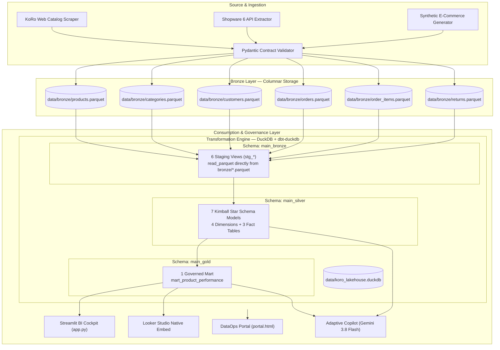

# 🏛️ KoRo Analytics Engineering — Single Source of Truth (SSoT)

> **治理聲明（Zero-Facade Standard）**：  
> 本文檔為 KoRo Lakehouse 平台的**唯一真實架構定義（Single Source of Truth, SSoT）**。  
> 文檔內所列出之每一項技術組件、資料模型、合約欄位與商業指標，**必須 100% 對應實體程式碼、實體資料庫，並通過所有自動化驗證**。嚴禁任何僅供展示但未落地的虛擬假架構。

---

## 1. 核心實體架構（Physical Lakehouse Architecture）

### 1.1 儲存與運算技術棧
* **Bronze Storage**：`data/bronze/*.parquet`（純實體 Parquet 列式儲存，支援 Schema 演進與高效壓縮）。
* **OLAP 運算引擎**：**DuckDB (In-Process OLAP)**，資料庫檔案位於 `data/koro_lakehouse.duckdb`。
* **資料轉換編排**：**`dbt-duckdb`**（專案目錄：`dbt_koro/`）。
* **自癒管線啟動**：`scripts/run_pipeline.py`（若檢測資料庫遺失，自動從來源重建 Bronze Parquet 並執行 `dbt run` 與 `dbt test`）。

---

## 2. 實體資料模型拓撲（3-Tier Medallion & Kimball Star Schema）

現行資料倉儲嚴格遵循 Ralph Kimball 星型模型維度建模規範，全系統共計 **14 個已落地的實體模型**：

### 2.1 Bronze Staging 層 (`main_bronze`)
以 View 形式直接掛載 `read_parquet`，進行基礎型別轉換與欄位重命名：
1. `stg_products`：商品原始目錄（商品名稱、包裝規格、基礎價格、在架狀態）。
2. `stg_categories`：品類階層（品類名稱、父品類識別碼）。
3. `stg_customers`：顧客屬性（國別、會員等級、註冊日期）。
4. `stg_orders`：訂單頭部資訊（訂單日期、顧客 ID、支付方式、訂單狀態）。
5. `stg_order_items`：訂單明細（商品 ID、購買數量、單價、折扣金額）。
6. `stg_returns`：退貨交易記錄（退貨 ID、訂單 ID、商品 ID、退貨原因、退貨數量、退款金額）。

### 2.2 Silver 維度與事實層 (`main_silver`)
已去除重複、完成實體關聯、遵循嚴格 Kimball 規範：
* **維度表（Dimension Tables）**：
  1. `dim_products`：商品核心維度（包含 `packaging_size`、`category_id`、`base_price_eur`、`is_available`）。
  2. `dim_categories`：商品分類維度（階層式品類分類）。
  3. `dim_customers`：顧客維度（國別分群與生命週期）。
  4. `dim_date`：標準時間維度（支援年、季、月、週、工作日分析）。
* **事實表（Fact Tables）**：
  5. `fct_orders`：訂單粒度事實表（訂單總額、折扣、運費、有效狀態）。
  6. `fct_order_items`：訂單品項粒度事實表（銷售數量 `sold_units`、原始銷售額、淨銷售額）。
  7. `fct_returns`：退貨粒度事實表（退貨數量 `returned_units`、退貨原因 `Packaging Defect`、`Quality Flaw` 等）。

> **維度治理鐵律**：
> 維度表（`dim_*`）嚴禁反向依賴事實表（`fct_*`）。事實表之間嚴禁跨領域交叉依賴。

### 2.3 Gold 商業市集層 (`main_gold`)
* **`mart_product_performance`**：
  * **粒度**：每個 `product_id` 一行記錄。
  * **上游血緣**：`dim_products`、`fct_order_items`、`fct_returns`。
  * **隱私等級**：`contains_pii: false`（完全去識別化與聚合指標）。

---

## 3. 資料合約與語意鎖（Code-Contract Bi-directional Lock）

實體 YAML 定義與 dbt 模型具備雙向強制校驗，嚴禁欄位偏離：

### 3.1 核心指標公式定義（`semantic/business_rules.yaml`）
* **Gross Revenue (總營收)**：`SUM(sold_units * unit_price_eur)`
* **Net Revenue (淨營收)**：`SUM(line_total_eur - discount_eur - refund_eur)`
* **Units Sold (銷售總量)**：`SUM(sold_units)`
* **Average Order Value (AOV)**：`Net Revenue / NULLIF(COUNT(DISTINCT order_id), 0)`
* **Average Selling Price (ASP)**：`Net Revenue / NULLIF(SUM(sold_units), 0)`
* **Return Rate % (退貨率)**：`ROUND(SUM(returned_units) * 100.0 / NULLIF(SUM(sold_units), 0), 2)`
* **Net Margin % (淨利率)**：`ROUND((SUM(net_revenue_eur) - SUM(cogs_eur)) * 100.0 / NULLIF(SUM(net_revenue_eur), 0), 2)`
* **Days of Supply (庫存天數)**：`current_stock_units / NULLIF(daily_sales_velocity, 0)`

---

## 4. 可觀測性與治理門禁（Observability & CI/CD）

1. **獨立 DataOps 門戶 (`docs/portal.html`)**：
   * 整合官方 **Elementary Report (`docs/elementary_report.html`)** 與 **dbt Docs (`docs/dbt_docs.html`)**。
   * 具備完整 9 節點 Kimball 血緣 DAG，背景色經純白優化，具備實體點擊跳轉。
2. **CI 門禁標準（`.github/workflows/ci.yml`）**：
   * 每次 Commit 必須在乾淨環境執行 `python scripts/run_pipeline.py`。
   * **18+ dbt Contract Tests 必須 100% PASS**（包含 `unique`, `not_null`, `relationships`）。
   * **Pytest 測試套件必須 100% PASS**（含 Looker 嵌入、適配器契約、自癒機制）。
3. **金魚防腐五大條款（Goldfish Anti-Smell Standard）**：
   * 單一方言原則：全庫與 LookML 嚴格使用 DuckDB / ANSI SQL (`main_silver.*`, `main_gold.*`)，禁止 BigQuery 偽語法。
   * 雙向鎖定：`contracts/*.yaml` 必須與 dbt schema 1:1 鎖定，維度屬性不得在事實表中重複宣告。
   * 零虛假容錯：禁止維護 memory shadow dataset，缺庫即強制自動觸發 pipeline。
   * 誠實測試：禁止使用 `assert "a" in html or "b" in html` 掩蓋 legacy artifact。
